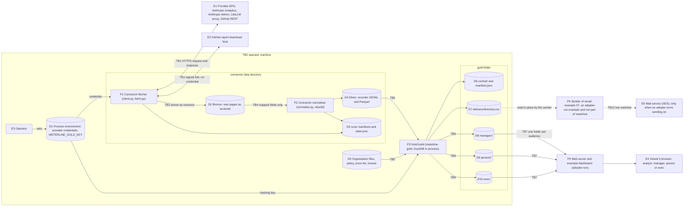

# meterline threat model

- **Date:** 2026-10-17. **Written against:** commit `79fccaf` of `main`, plus the change set that adds this file. **Amended 2026-10-30:** the Anthropic Admin key (A7), the gold key's trust boundary (TB10), the calibration script (TB11) and rows T24 to T26. **Amended 2026-11-05:** example 07 as a sender of email (P5, E5, TB12, rows T29 to T31) and a note under T10.
- **Covers:** the connectors (`meterline-anthropic`, `meterline-anthropic-admin`, `meterline-litellm`, `meterline-copilot`), the record format (`meterline`), `meterline-gold` and its example dashboard, and [example 07](../examples/07-person-messages/README.md) as a sender of email (an adopter's example, not part of meterline). `meterline-sim` is out of scope: it invents all its data and opens no network connection.
- **Owners named below:** the **maintainer** (the code in this repository) and the **adopter** (whoever installs meterline and runs it on their organisation's data). Where a threat can only be handled where meterline runs, the adopter owns it.
- **Read with:** [`PRIVACY.md`](PRIVACY.md) (what personal data each layer holds, retention, erasure), [`../SECURITY.md`](../SECURITY.md) (how to report a vulnerability) and the privacy section of [`../packages/meterline-gold/README.md`](../packages/meterline-gold/README.md#privacy).

## Update triggers

Revisit this file, and change its date and commit line, when any of these happens:

1. A connector, an endpoint or a network destination is added (a sender of email, a new provider, a new download host).
2. An output file or column that holds a person's data is added, or an audience folder changes.
3. The handling of a credential or of `METERLINE_GOLD_KEY` changes.
4. A connector is first run against a live organisation (assumption A1 below).
5. The dashboard changes, or a runtime dependency is added.

The first trigger fired on 2026-11-05: [example 07](../examples/07-person-messages/README.md) is a sender of email, so the diagram gains P5 and E5, the trust boundaries gain TB12 and the table of threats gains T29 to T31, with a note under T10.
6. A vulnerability report is received.
7. Otherwise once a year.

## What is worth protecting

| ID | Asset | Where it lives |
|---|---|---|
| A1 | Provider credentials: the Anthropic Analytics key (`ANTHROPIC_ANALYTICS_KEY`), the LiteLLM admin key (`LITELLM_API_KEY`), the GitHub tokens (`COPILOT_TOKEN`, `COPILOT_BILLING_TOKEN`). Each can read the whole organisation's usage. The Anthropic Admin key has its own row, A7. | The process environment only. |
| A2 | The gold hashing key `METERLINE_GOLD_KEY`. Whoever holds it and a list of person ids can turn every pseudonym back into a person. It goes to no host: it stays in the process that builds gold. | The process environment only. |
| A3 | Direct identifiers: email addresses, logins, provider user ids, given and family names, person ids. | Bronze and silver (connector data directory), the organisation files, `delivery/directory.csv`. |
| A4 | Per-person usage and cost figures. | Silver, gold `central/` and each `person/<key>/` folder. |
| A5 | Small-group figures that suppression withholds. | Gold `central/` only (the audience folders hold them suppressed). |
| A6 | Correct figures: a wrong cost or a wrong person attribution leads to a wrong decision about a person. | Every layer. |
| A7 | The Anthropic Admin key (`ANTHROPIC_ADMIN_KEY`), read by `meterline-anthropic-admin`. It is not read-only and has no scopes: besides the usage and cost reports it can manage the Console organisation's members and roles, invites, workspaces and workspace members, and API keys. Whoever holds it can do those things as well as read the organisation's API usage and billed cost. | The process environment only. It is sent only to `api.anthropic.com`, as the `x-api-key` header of two `GET` requests. |

## Data-flow diagram

Element IDs: `E` external entity, `P` process, `D` data store. The boxes drawn around elements are the trust boundaries of the next section.

## Trust boundaries

| ID | Boundary | What crosses it | What holds at the crossing |
|---|---|---|---|
| TB1 | **provider API to connector** (E1, E2 to P1) | The credential goes out; raw responses come in over the internet. | HTTPS with certificate checks (the `httpx` default; nothing in the code turns it off), redirects not followed, so a credential never reaches a second host; the download host gets no credential and must be `https`; page counts are capped and a repeating cursor stops the query. |
| TB2 | Operator machine to process (E3, D1 to P1, P3) | Credentials and the hashing key enter from the environment. | Read from the environment only, never from an option or a file, and never written anywhere (the key tests named under T3). |
| TB3 | **raw to bronze** (P1 to D2) | Each response page, stored as received, gzip-compressed. | Nothing is filtered here: bronze holds whatever the provider sent, emails and any unexpected field included. A page is never replaced or deleted by the connector. |
| TB4 | **bronze to silver** (D2 to P2 to D4) | Only the fields the record format names. | A missing required field fails the run; a field the connector does not map, such as free text, never reaches a record (tests `test_prompt_content_never_written_*`). Silver still holds emails, logins and ids as the provider sent them. |
| TB5 | **silver to gold** (D4, D5 to P3) | Records, organisation files and the hashing key. | The pseudonymisation boundary: every person and actor becomes a keyed hash (HMAC-SHA256, key of at least 32 bytes); every record is validated again; names and emails go only to `delivery/`. |
| TB6 | **gold `central/` to each audience folder** (P3 to D8 `manager`, D9 `person`, D10 `exec`) | Figures filtered and suppressed for one audience. | A group figure is published only for at least `k` persons and the suppression loop hides cells that give a small group away; a `person` folder holds only that person's rows; a `manager` folder holds the cells they head and count-valued rules about their reports; `exec` holds groups down to its depth. `central/` and `manifest.json` go to central analysts only (`meterline_gold.servable` is `True` for them and `False` for every other audience); `delivery/` goes to nobody. |
| TB7 | **audience folder to dashboard and viewer** (D8-D10 to P4 to E4) | Whatever sits in the served folder. | One audience folder per web root, behind the adopter's access control; the **dashboard** renders every value as text under a content security policy. |
| TB8 | Files to other users of the same machine (D2-D10) | File reads by another local account. | The connectors, gold, the simulator and the example scripts `examples/02-exec-report/report.py` and `examples/03-daily-job/job.py` create every file `0600` and every folder `0700`, whatever the umask (`test_output_files_private_permissions` in `meterline-anthropic`, `meterline-litellm`, `meterline-copilot` and `meterline-gold`; `test_output_is_private_whatever_the_umask` in `meterline-anthropic-admin`; `test_output_private_sim`, `test_output_private_example_02`, `test_output_private_example_03`). |
| TB9 | **Admin key to the Anthropic organisation** (D1 to P1 to E1, host `api.anthropic.com`) | `ANTHROPIC_ADMIN_KEY` goes out in the `x-api-key` header of two requests: `GET /v1/organizations/usage_report/messages` and `GET /v1/organizations/cost_report`. | The key cannot be narrowed: the provider would accept the same key on requests that change members, workspaces and keys. What holds is meterline's own conduct: the client has one request call, `get`, and no option names another host (`tools/test_security_docs.py` scans it for any other method); redirects are not followed; the key is masked in error text (`test_done_check_A10_*`). Dedicated key, expiry, rotation and revocation are the adopter's (admin README, "What the Admin key can do"). |
| TB10 | **Gold key into the gold build** (D1 to P3, no host) | `METERLINE_GOLD_KEY` enters `meterline-gold` from the environment (or the `key` argument of `meterline_gold.build`). | At least 32 bytes or the build exits with an error; it is used only for HMAC-SHA256 and is never written. The manifest holds `key_check`, which tests a guessed key but does not reveal it (T21). Rotation changes every `pk_`, `ak_` and `kc_` value and every `person/<key>/` folder name, and the build never touches an earlier folder (SECURITY.md, "The gold hashing key"). |
| TB11 | **Calibration script to the Anthropic Messages API** (operator, `tools/calibrate_anthropic_admin.py`, host `api.anthropic.com`) | Without `--compare` it sends `POST /v1/messages` calls that cost real money, with `ANTHROPIC_API_KEY` from the environment: a standard key of a dedicated workspace, not an Admin key. | It is the only code in this repository that sends a request other than `GET`. It makes a fixed plan of calls, stops before a call that could take the total past 2.00 USD (a mocked test, `test_done_check_A13_the_guard_stops_the_run_before_2_usd_is_spent`), and refuses to start at or after 20:00 UTC. The workspace's own spend limit is the hard stop. It writes the response `usage` blocks and request ids to `calibration-<date>.jsonl`, never the key. `--compare` makes no request and needs no key. The owner runs it; no test does. |
| TB12 | **Sender to the mail service** (P5 to E5; example 07 with `--send`; host: the SES endpoint of the adopter's region) | A message as the bytes of an `.eml` file: the recipient's name and address and their own figures. Only when an adopter turns sending on; the default path writes files and opens no connection. | `--send` and `METERLINE_MAIL_CONFIRM=yes` are both needed; sending is refused whenever `CI` is set and when `--sender` is the example address; `boto3` is imported on that path only and is no dependency of any meterline package; the AWS credentials are the adopter's, from the environment, and the example never reads them. The sending code is tested for its refusals only: no test and no CI job sends. The agreement with the mail provider, the sender identity and the handling of bounces are the adopter's ([`PRIVACY.md`](PRIVACY.md#transfers)). |

## STRIDE

One row per threat. Element is the diagram ID; the category is the STRIDE letter; the response is one of mitigate, eliminate, transfer or accept.

| ID | Element | Category | Threat | Response | Owner | Control or evidence |
|---|---|---|---|---|---|---|
| T1 | P1 | S Spoofing | A host posing as the provider API (DNS or proxy interception) receives the credential. | mitigate | maintainer | HTTPS defaults for Anthropic and GitHub, certificate checks on, redirects not followed. |
| T2 | P1 | S Spoofing | The operator sets `LITELLM_BASE_URL` to a wrong host or to plain `http://`, and the admin key travels there. | accept | adopter | The base URL is trusted configuration (assumption A5); a user and password written into the URL are stripped before use, and never reach a raw file (`test_request_url_in_raw_files_drops_base_url_credentials`). |
| T3 | D1 | I Information disclosure | A credential or the hashing key lands in a file, a log line, a manifest, the state file or the text of an exception. | mitigate | maintainer | `test_key_in_every_sink_anthropic.py`, `_litellm.py`, `_copilot.py` (success and failing runs); `test_gold_key_never_in_outputs.py`. |
| T4 | D2 | I Information disclosure | Another local account reads bronze, silver or gold files, which hold emails and per-person costs. | mitigate | maintainer | Files `0600` and folders `0700` whatever the umask (`test_output_files_private_permissions`). Backups, synced folders and copies made for an audience stay with the adopter. |
| T5 | D9 | I Information disclosure | An audience folder shows another person's figure, or lets a reader recover a suppressed small-group figure. | mitigate | maintainer | Suppression at `k` and the loop of spec 7.4; `test_done_check_G11_privacy_property` (an exact linear attacker must fail), `test_done_check_G15_fixture_audience_isolation`, `test_review_decision9_person_files.py` (no other person's key in a person folder). |
| T6 | D10 | I Information disclosure | A reader who keeps every refresh of a month in progress learns one person's usage between two refreshes, or a late correction from the difference. | accept | adopter | `meterline-job` freezes a closed month and delivers it once (`test_publish_*`); managers and executives are given only the latest published state, and what remains for a month in progress is a documented limit. The adopter decides before go-live whether to accept it, and records the decision (gold README, "Refreshes of one month"). A month corrected after its delivery is re-delivered, and a recipient who kept the earlier version can compare the two: a residual risk the adopter records too (see "Correcting a delivered month" in [PRIVACY.md](PRIVACY.md#correcting-a-delivered-month-or-applying-a-stricter-policy)). |
| T7 | D6 | I Information disclosure | `manifest.json` or `central/` is served or sent to an audience; it lists every person and manager key. | transfer | adopter | Gold README: the manifest is central-only; never serve the gold root. |
| T8 | P4 | E Elevation of privilege | A hostile value in an organisation file (a name, a unit name) runs script in a viewer's browser through the dashboard. | mitigate | maintainer | Every value is set as text (no HTML sink); a content security policy allows only the page's own inline script and style by hash and requests to its own folder (`test_review_f33_dashboard_csp.py`). |
| T9 | P4 | S Spoofing | A viewer opens a folder meant for another person or manager; the dashboard has no login. | transfer | adopter | The web server and its access control belong to the adopter; one audience folder per web root. |
| T10 | D7 | I Information disclosure | `delivery/directory.csv` (names and emails) is served or copied to an audience. | transfer | adopter | Gold README: never serve `delivery/`; it exists for a sender, which meterline does not include. [example 07](../examples/07-person-messages/README.md) is such a sender: it runs on the central side, reads the file in place from `builds/<latest>/delivery/`, never copies or serves it, and has no option to read a directory from anywhere else (T29 to T31). |
| T11 | P1 | D Denial of service | A provider answers with an endless cursor or more pages than any real organisation has, and a run never ends. | mitigate | maintainer | `MAX_PAGES` and a repeated-cursor check in every connector (`test_pagination_*`; in `meterline-anthropic-admin`, `test_done_check_A02_*`); `Retry-After` is capped (`test_retry_after_cap_*`; in `meterline-anthropic-admin`, `test_done_check_A03_*`). |
| T12 | P2 | D Denial of service | A very large page or report file exhausts memory: each is read and decompressed whole. | accept | adopter | Provider responses are trusted to be of normal size (assumption A2). |
| T13 | E1 | T Tampering | A provider response with a missing field, a changed shape or unexpected free text yields wrong or leaking records. | mitigate | maintainer | Missing required fields fail the run (`test_missing_required_fields_*`); unmapped fields never reach silver (`test_prompt_content_never_written_*`); shape done-checks against the documented shapes. |
| T14 | D2 | T Tampering | A later pull replaces a raw page, so a rebuild no longer reproduces the records it once produced. | mitigate | maintainer | Raw files are never replaced (`test_raw_not_overwritten_*`). |
| T15 | D4 | T Tampering | Someone with write access to the data directory edits silver or the organisation files to move cost between persons. | accept | adopter | Out of scope: write access to the data directory is trusted. Gold validates every record and runs its assertions; raw pages let a rebuild be compared. |
| T16 | P3 | T Tampering | A value in an input reaches SQL as code, or a person id containing `../` makes gold write outside `--out`. | mitigate | maintainer | Values are bound as parameters; folder names are hash keys only. The identifier check on the dynamic SQL is open, planned in this pull request (F-33). |
| T17 | P3 | E Elevation of privilege | A policy or price file runs code when it is loaded. | mitigate | maintainer | YAML is read with `yaml.safe_load`; no `eval`, `pickle`, `subprocess` or shell call in any package source. |
| T18 | D3 | R Repudiation | Nobody can tell which run produced a record, or which inputs a gold folder came from. | mitigate | maintainer | `batch_id` on every record, one manifest per run under `runs/`, raw pages kept; gold `manifest.json` holds the hash of every input and output. |
| T19 | P4 | R Repudiation | Nobody can tell who viewed a person's folder. | transfer | adopter | Access logging belongs to the adopter's web server. |
| T20 | D2 | I Information disclosure | The short unkeyed sha256 labels in raw folder names (LiteLLM entity tag, Copilot login tag) confirm a guessed email or login. | accept | adopter | Documented in the gold README ("Keys rotate with the key"); keep raw folders as closed as silver. |
| T21 | D6 | I Information disclosure | The `key_check` value in `manifest.json` lets someone test guesses of a weak hashing key offline. | mitigate | adopter | The key must be at least 32 bytes (exit 2 otherwise); the adopter uses a random key (assumption A6). |
| T22 | P3 | T Tampering | A compromised dependency (`httpx`, `duckdb`, `pyarrow`, `pydantic`, `PyYAML`) changes figures or leaks data. | accept | maintainer | CI actions are pinned by commit and gitleaks scans every pull request; dependencies are not yet pinned or audited. |
| T23 | D6 | T Tampering | A value starting with `=`, `+`, `-` or `@` in an organisation file runs as a formula when a reader opens a gold CSV directly in a spreadsheet. | accept | adopter | gold writes values as they are; its README says to import the files as text (`test_review_f33_csv_formula_cells.py`). |
| T24 | D1 | E Elevation of privilege | A stolen Anthropic Admin key (from the operator's environment, a shell history, a job file, a backup) lets its holder change the Console organisation, not only read it: members and roles, invites, workspaces, API keys. | mitigate | adopter | meterline cannot narrow the key. It never writes it (T3) and sends it only to `api.anthropic.com` (TB9). The adopter makes a dedicated key with an expiry, rotates it and revokes it at once on a leak, as the admin README ("What the Admin key can do") says. |
| T25 | E1 | T Tampering | A hostile or damaged Admin report (a wrong figure, a changed shape, free text in a field such as `description`) yields wrong costs or text in the records. | mitigate | maintainer | Every field is checked against the documented shape; an unknown, missing or wrongly typed field stops the run with exit 2 and nothing is published (`test_done_check_A09_*`). `description` and the account ids are kept in raw pages only. A well-formed but wrong amount is not detected; the calibration (TB11) and a comparison with the Console are the cross-check. |
| T26 | P1 | D Denial of service | A run of `tools/calibrate_anthropic_admin.py` spends more than intended: a key of a workspace with no spend limit, or the script run twice. | accept | adopter | The script's own 2.00 USD guard and the workspace spend limit (TB11). The owner runs it by hand. |
| T27 | P1 | I Information disclosure | A run's error text names an identifier: the unknown-field report of every connector names a field the provider sent (it could look like an email) and never its value, the Admin workspace check names an `api_key_id`, and the gold identity-overlap error names a provider account id (it can be an email). The report is kept in `unknown_fields` and the workspace check in `failures` of `runs/<batch_id>.json`. | accept | adopter | Documented in the README and in [`PRIVACY.md`](PRIVACY.md) ("Error messages that name an identifier"): treat stderr and manifests as sensitive. `test_an_unknown_field_name_is_echoed_in_the_unknown_fields_report` pins what the report names. |
| T28 | D10 | I Information disclosure | A reader of `exec/seats_month.csv` works out or estimates a withheld `active_seats` or `idle_seats` from the shown `seats_billed`, `seats_on_eval_day` and the other count. | accept | adopter | Documented in the README ("Security and data handling"). Gold tests each count against `k` on its own; the `hidden` flag carries no reason. Deliver the exec seat counts only where a small group's seat use is not sensitive. |
| T29 | P5 | I Information disclosure | Example 07 sends a message to the wrong recipient, or one person's figures, name or key reach another person's message (a join on the wrong column, a key in a header or in a file name). | mitigate | maintainer | Recipients are joined on `person_key`; a key missing from the directory, a name or address with a control character, or a person with no row for the month gets no message; no key is in a header, a body or a file name (`tools/test_example_07_messages.py` searches every part and header of one person's message for a second person's sentinel name, address and figures, and was shown failing with a join by position). A wrong address in the directory itself is the adopter's, accepted. |
| T30 | P5 | E Elevation of privilege | A job or a CI run gains the ability to send through example 07: `--send` is run by a script, a scheduled job or a pull request build, and names and figures go to a mail service that nobody switched on. | mitigate | maintainer | Sending needs `--send` and `METERLINE_MAIL_CONFIRM=yes`, is refused when `CI` is set (exit 2, before anything is read or written) and refuses the example sender address; `boto3` is imported on the send path only; no test and no CI job sends, and `tools/test_example_07_messages.py` tests the refusals. A person at a prompt can still run it: who may is the adopter's. |
| T31 | D7 | I Information disclosure | The `.eml` files of example 07 hold a name, an address and figures in plain text, and the folder is copied, synced, committed or left behind. | transfer | adopter | The files are written `0600` into a new folder `0700` outside the gold root, and the repository ignores `*.eml` and `/mail-out/`. Backups and synced copies of the folder, and deleting it after sending, are the adopter's; the example sets no expiry. |

## Static analysis

bandit and ruff's `S` rules run clean over `packages/*/src`. Five lines carry a suppression, each with its reason on the line: the dynamic table load in gold's `load.py` (B608: names and types are checked against the code's own list before they reach SQL; row values travel in a CSV file and its path is a bound parameter; `test_review_f33_sql_identifiers.py`), two environment-variable names in the Copilot CLI (B105), a type-checker assertion in the Copilot fetcher (B101) and the simulator's seeded random draws (B311). `tools/test_security_privacy_docs.py` runs ruff's `S` rules when ruff is installed and checks that every suppression states a reason.

## OWASP LLM Top 10

Not applicable: no model is called at run time. meterline reads usage figures about model calls from provider APIs and never sends a prompt to a model or runs a model's output.

## OWASP ASVS 5.0

Target level: **L1** for the tool as a whole, **L2** for the chapters that protect outputs holding emails or cost (marked L2 below). meterline is a command-line tool and a static page, not a web application, so the chapters about sessions, logins and APIs it serves do not apply; the web server that serves the dashboard is the adopter's.

| Chapter | Applies | Level | How meterline meets it, or the gap |
|---|---|---|---|
| V1 Encoding and Sanitization | yes | L1 | SQL values are bound parameters and SQL names are checked (T16); the dashboard sets every value as text; CSV values are written as they are and documented as not spreadsheet-safe (T23). |
| V2 Validation and Business Logic | yes | L2 | Every record is validated when written and again when gold reads it; organisation files are checked line by line; a missing required provider field fails the run (T13). |
| V3 Web Frontend Security | yes (dashboard) | L1 | Content security policy with hashed inline script and style, no external request, no HTML sink (T8). |
| V4 API and Web Service | no | - | meterline serves no API. |
| V5 File Handling | yes | L2 | Output paths are built from hash keys, never from input text (T16); outputs are `0600`/`0700` (T4); raw pages are never replaced (T14). |
| V6 Authentication | no | - | No login of its own; the dashboard's access control is the adopter's web server (T9). |
| V7 Session Management | no | - | No sessions. |
| V8 Authorization | partly | L2 | Audience folders carry only what their audience may see (T5); who may open which folder is the adopter's (T9). |
| V9 Self-contained Tokens | no | - | No tokens issued. |
| V10 OAuth and OIDC | no | - | Provider credentials are static keys and tokens read from the environment. |
| V11 Cryptography | yes | L2 | HMAC-SHA256 with a key of at least 32 bytes for pseudonyms; no home-made cryptography; the unkeyed raw labels are a documented exception (T20). |
| V12 Secure Communication | yes | L1 | HTTPS with certificate checks to the providers, redirects not followed (T1); the LiteLLM URL is trusted configuration (T2). |
| V13 Configuration | yes | L2 | Credentials and the hashing key come from the environment only and are never written (T3); `.env` is ignored by git and CI scans for secrets. |
| V14 Data Protection | yes | L2 | Pseudonyms, suppression and audience folders (T5); retention and erasure in [`PRIVACY.md`](PRIVACY.md); owner-only files (T4). |
| V15 Secure Coding and Architecture | yes | L1 | No `eval`, `pickle` or shell; YAML through `safe_load` (T17); dependencies not yet pinned (T22). |
| V16 Security Logging and Error Handling | yes | L2 | Logs carry counts and statuses, never a key; they carry no email, with three known exceptions (T27): the unknown-field report names a field the provider sent (never its value), the Admin workspace check names an `api_key_id`, and the identity-overlap error names the provider account id. Errors name the file and line at fault (T3). No security event log: there is no login to record. |
| V17 WebRTC | no | - | Not used. |

**Delivery rule (T6, A8).** A month is refreshed on every published run until it is frozen, which happens once every source has final data for it and `freeze_after_days` have passed, or at the latest `freeze_after_days + freeze_cap_extra_days` days after its end at the next run; from then on it is delivered once and does not change, except that the manual erasure procedure removes an erased person's rows (the tool has no erase command), and after a change of the hashing key manager and person folders show only months frozen under the new key. Each reader receives only their own sub-folder of `published/`, as `servable(path, audience)` says, never `builds/` or `frozen/`, and managers and executives are given only its latest state; keeping earlier states is the adopter's choice, not the tool's. A reader who keeps every refresh of an in-progress month can sometimes learn one person's usage between two refreshes, one person's month-to-date amount when a correction or an organisation change moves that person, a cell published in one refresh and hidden in the next, or a named exception that appears and then disappears; and a recipient who kept an earlier version of a month can compare it with the version delivered again after a correction. The adopter decides before go-live whether to accept these risks, records the decision and has it validated by its data protection officer. The table of who receives which folder is [Who gets which folder](../packages/meterline-gold/README.md#who-gets-which-folder).

## Bug bar

How a report is graded. A finding at **High** or above blocks a release.

| Severity | Meaning | Examples |
|---|---|---|
| Critical | A credential or the hashing key leaves the process, or code runs from input data. | A key in any file, log, manifest, exception or output; a credential sent to a host other than the configured one; script run from a CSV value. |
| High | A person's data reaches someone the design says must not see it. | An email, name or login in an audience folder; another person's figure or a suppressed figure recoverable from one build; a write outside `--out` or `--data-dir`; outputs readable by other local accounts by default. |
| Medium | Availability, or a privacy limit beyond the documented ones. | A provider answer that makes a run loop forever or exhaust memory; a leak across two refreshes or builds of one month larger than the documented one; a dashboard injection that only the content security policy stops. |
| Low | Hardening with no direct exposure. | A static-analysis finding with no written justification; a missing header; a count disclosed where none is needed. |

## Attack tree

Leaves say how each path stands today. OR: any child reaches the parent. AND: every child is needed.

- **Goal: exfiltrate the admin key or per-person emails** (OR)
  - 1 Get a provider credential (OR)
    - 1.1 Read it from a file the tool writes (raw, records, manifests, state file): mitigated, T3.
    - 1.2 Read it from a log line or the text of an error: mitigated, T3 (the key is masked in errors).
    - 1.3 Make the tool send it elsewhere (OR)
      - 1.3.1 A provider redirect to another host: mitigated, redirects not followed.
      - 1.3.2 Interception on the way: mitigated, HTTPS with certificate checks (T1).
      - 1.3.3 A wrong or plain-`http` LiteLLM base URL: accepted, trusted configuration (T2, A5).
    - 1.4 Find it in git: mitigated, `.env` is ignored and gitleaks scans each pull request.
    - 1.5 Read the operator's environment or shell history on the machine: transferred to the adopter.
  - 2 Get per-person emails (OR)
    - 2.1 Read bronze or silver as another local account: mitigated, owner-only files and folders (T4).
    - 2.2 Read them in logs or manifests: mitigated, the connectors log counts and statuses only (tested); the exceptions are T27.
    - 2.3 Fetch `delivery/directory.csv`, `central/` or `manifest.json` from the dashboard's web server: transferred, serve one audience folder only (T7, T10).
    - 2.4 Put script in an organisation file so the dashboard reads other files of its origin: mitigated, values set as text; the served folder holds one audience's files only (T8).
    - 2.5 Turn a pseudonym back into a person (AND)
      - 2.5.1 Get `METERLINE_GOLD_KEY`: mitigated, never written (T3), at least 32 bytes.
      - 2.5.2 Hold the list of person ids: held by the adopter's organisation files.
    - 2.6 Confirm a guessed email against an unkeyed raw folder label: accepted, documented (T20).
    - 2.7 Copy a backup or a synced copy of the data directory: transferred to the adopter.
    - 2.8 Have a sender mail the directory, or a person's figures, to the wrong recipient: example 07 joins on `person_key` and reads the directory in place (T29); a sender of your own is yours to test; see [`PRIVACY.md`](PRIVACY.md) before sending is switched on.

## Assumptions

| ID | Assumption | Impact if wrong | Who can tell | Follow-up |
|---|---|---|---|---|
| A1 | The connectors read the providers' documented response shapes. Only `meterline-anthropic-admin` has been run against a live account, on a small Console organisation (one model, two days of usage); the other three have never been run against a live account. | A field is missed or mapped wrong, so figures are wrong; a live field could carry text the mapping does not expect. | The first adopter who runs a connector live; the shape done-checks then show the difference. | Save the live shape (synthetic values only) as the new shape file and rerun the done-checks; then update this row. |
| A2 | Provider pages and report files are of normal size: each is held and decompressed in memory whole. | A huge or hostile answer exhausts memory and the run dies (no data leaves). | The operator, from an out-of-memory failure. | Add a size cap on a response and on decompression if a live run shows large files. |
| A3 | Accounts on the machine that runs meterline are not adversaries with administrator rights; file permissions protect only against other ordinary accounts. | An administrator or a backup reads every layer. | The adopter. | Disk encryption and backup handling are the adopter's. |
| A4 | Organisation files, the policy and the price list are written by the operator, not by the persons they describe. | A hostile value reaches the CSVs (formula injection in a spreadsheet) and the dashboard. | The adopter. | The dashboard renders text only; the gold README says how to open the CSVs safely. |
| A5 | `LITELLM_BASE_URL` is trusted configuration and uses `https`. | The admin key travels in clear or to a wrong host. | The operator. | Consider refusing `http://` without an explicit flag. |
| A6 | `METERLINE_GOLD_KEY` is random, at least 32 bytes, and stored apart from the outputs. | Pseudonyms can be reversed by guessing; the manifest's `key_check` confirms a guessed key. | The adopter. | [`PRIVACY.md`](PRIVACY.md) says how to make, store and rotate it. |
| A7 | Each audience folder is served alone, behind the adopter's access control. | Anyone who reaches the server reads that audience's files. | The adopter. | Nothing in meterline can enforce this. |
| A8 | Managers and executives are given only the latest published state of a month in progress, and a closed month once. | A reader who keeps every refresh can read one person's usage or a correction from the difference. | Nobody inside meterline. | Give each reader only their own sub-folder of `published/`, as `servable(path, audience)` says; the delivery rule in this page says the rest. |
