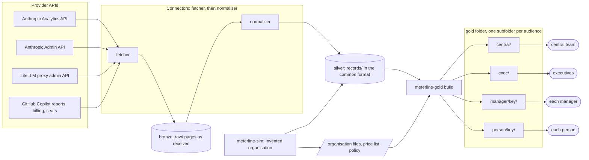

# Architecture

meterline moves usage data through three layers: *bronze* (what each provider sent), *silver* (the common
records) and *gold* (datasets built from the records for each audience, with the privacy rules applied). Each
layer is a folder of files, written by one program and read by the next, so each step can be run, checked and
repeated on its own. The words in *italics* are defined in the [glossary](glossary.md).

## The picture

The simulator stands in for the connectors on invented data: it writes silver and the organisation files
directly, plus a ground truth that the gold tests compare against.

## The layers

| Layer | Written by | Where | Holds | Read by |
|---|---|---|---|---|
| bronze | a connector's fetcher | `<data-dir>/raw/` | every response page as received, compressed | the normaliser, and `rebuild` |
| silver | a connector's normaliser, or the simulator | `<data-dir>/records/` | records of the five kinds, one JSON line each | gold, or any reader of the format |
| gold | `meterline-gold build` | the `--out` folder | datasets per person, group and audience; a manifest | the audiences, the example dashboard |

The table reads left to right in the order a day's data travels: from the API to bronze, from bronze to silver,
from silver to gold.

## Why the steps are separate

- **The fetcher and the normaliser are two programs in one connector.** The fetcher only talks to the API and
  writes bronze; the normaliser only reads bronze and writes silver. They are tested apart, and `rebuild` can
  re-create every record from bronze with no API call and no key, byte for byte.
- **Silver is one format for every provider.** Gold, or any other reader, never needs to know which provider a
  record came from. The differences that matter, such as whether a cost is billed or an estimate, are fields
  (`cost_basis`), not reader knowledge.
- **Gold is a separate package with no network.** It reads files and writes files. It is the only step that
  knows people, units and audiences, so the privacy rules live in one place, and a gold folder can be rebuilt
  from the same inputs with the same bytes.
- **Each audience gets its own folder, already filtered.** The rules are applied when the folder is written,
  not when it is served, so a folder handed to an audience holds nothing that audience may not see.

## Revisions and history

A provider can revise a period after it was first read. A connector then writes a new *batch* holding only the
records that changed; a reader takes the latest batch for each record key, and earlier batches stay readable.
Bronze keeps every page of every run, so the evidence behind any batch remains.

## Where the personal data is

Bronze and silver hold emails, logins and provider ids as the provider sent them; gold replaces each person by a
keyed hash, and only `delivery/` holds names. [PRIVACY.md](PRIVACY.md) lists what each layer holds and how long to
keep it; [THREAT-MODEL.md](THREAT-MODEL.md) has the trust boundaries between the layers.

## Further reading

- [records.md](records.md): every silver field and its source per connector.
- [decisions/](decisions/): why the format is as it is, with the alternatives considered.
- [`packages/meterline-gold/README.md`](../packages/meterline-gold/README.md): every gold folder and dataset.
