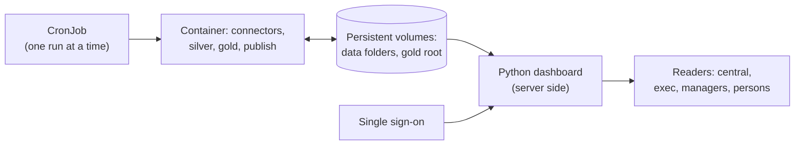

# B. Kubernetes and a Python dashboard

A Kubernetes CronJob runs the job in a container, and a Python dashboard serves each reader the published folder of their own audience. The [base page](README.md) defines the marks and what every scenario shares.

The table below lists the steps and who builds each. [Example 04](../../examples/04-container/README.md) holds the Dockerfile, the CronJob and the task definition for Amazon ECS.

| Step | How | Maturity |
|---|---|---|
| Image | build the Dockerfile of [example 04](../../examples/04-container/README.md) from the repository root; meterline publishes no image | built |
| Registry | push the image to the organisation's registry | pattern |
| Schedule | the CronJob of example 04, with `concurrencyPolicy: Forbid` and no overlapping start | pattern |
| Storage | one persistent volume for the data folders and one for the gold root, the whole root, because `published` is a relative link | pattern |
| Keys | provider keys and `METERLINE_GOLD_KEY` from Kubernetes secrets, as environment variables; never in the image or the manifest | pattern |
| Connectors, silver step, gold, publish | `meterline-job run CONFIG` in the container, as in [example 04](../../examples/04-container/README.md) | built |
| Dashboard | the process of [example 05](../../examples/05-dashboard/README.md), one per audience, or an app of your own (Streamlit, Dash or similar) that reads `published/<audience>` | built |
| Who sees what | sign-in through the organisation's single sign-on; the server maps the signed-in email to a `person_key` with `delivery/directory.csv`, then starts or selects the process of that audience and serves only what `servable()` allows | pattern |

**Least mature step:** pattern

**The joined route** is example 04, then example 05, on the same gold volume. Run the "Run it" block of [example 04](../../examples/04-container/README.md), then the [container block of example 05](../../examples/05-dashboard/README.md#run-it-in-the-container), and finish with example 04's "Clean up". The image of example 04 carries the dashboard; its server mode needs `--host 0.0.0.0` inside the container and the port published on the host's loopback only, and has no sign-in.

**The lock is tested on local disk only.** A network disk, such as NFS or a managed file share, is the adopter's to verify: run two jobs against one data folder and check that the second exits 1. A scheduler must also run one job at a time per data folder, which is what `concurrencyPolicy: Forbid` does.

The access step is the largest piece of work in this scenario. The mapping file holds names and emails, so only the dashboard's server reads it, never a browser, and it lives in `builds/`, which a dashboard must not serve. What a dashboard serves a reader is checked with [`servable(path, audience)`](../../packages/meterline-gold/README.md#who-gets-which-folder): only that reader's sub-folder of `published/`. A person's `manager/<key>/` folder exists only when that person heads a unit, and its key is the person's own `person_key`.
