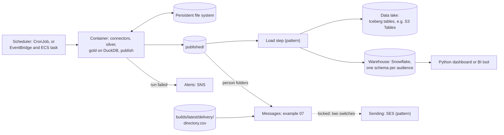

# C. Containers, a data lake and a warehouse

The job runs as in [B](b-kubernetes.md), on a container platform, and gold stays on DuckDB. The published folder is then loaded into the organisation's data lake and warehouse, and people read the warehouse. The excerpts below name AWS and Snowflake services; the same split holds with other providers. Two parts are built and run on simulated data: the warehouse layout, on a local DuckDB stand-in ([example 06](../../examples/06-warehouse-duckdb/README.md)), and one message per person, written as files ([example 07](../../examples/07-person-messages/README.md)). Both run in the image of [example 04](../../examples/04-container/README.md) on its gold volume: run example 04, then example 06 and example 07, each from its "Run it in the container" block ([06](../../examples/06-warehouse-duckdb/README.md#run-it-in-the-container), [07](../../examples/07-person-messages/README.md#run-it-in-the-container)), on the same gold volume; each writes into a volume of its own, and the message block never sends. Loading into Snowflake and S3 and sending through SES are patterns: the page gives commented excerpts to assemble, and meterline neither runs nor tests them. The [base page](README.md) defines the marks and what every scenario shares.



The table below lists the steps and who builds each.

| Step | How | Maturity |
|---|---|---|
| Schedule | a Kubernetes CronJob, or an ECS task started by EventBridge Scheduler | pattern |
| Storage | a file system that outlives the task, such as EFS, for the data folders and the gold root | pattern |
| Connectors, silver step, gold, publish | `meterline-job run CONFIG` with `parquet = true`, in the image of [example 04](../../examples/04-container/README.md) | built |
| Warehouse layout on a local stand-in | one database file per audience, a restricted file for the connection-to-key table, and a load that replaces what the last build left: [example 06](../../examples/06-warehouse-duckdb/README.md) | built |
| Per-person messages | one `.eml` file per person from `published/person/<key>/` and the delivery directory, sending locked: [example 07](../../examples/07-person-messages/README.md) | built |
| Load into the lake (S3 excerpt) | copy each published build's Parquet files into Iceberg tables or into a bucket, once per build date, with the S3 excerpt below | pattern |
| Load into the warehouse (Snowflake excerpt) | one schema per audience, tables replaced at each build, secure views and grants, with the Snowflake excerpt below | pattern |
| Read | Streamlit, in Snowflake or in a container, or any BI tool | pattern |
| Alerts | on a non-zero exit of the job, a message to an SNS topic, through the scheduler or a short wrapper | pattern |
| Send the messages (SES excerpt) | send the files of example 07 through SES, with the SES excerpt below | pattern |

**Least mature step:** pattern

## The warehouse rules

These rules keep the warehouse as private as the folders are. They are the rules that example 06 shows on its stand-in and that the Snowflake excerpt writes as grants.

1. **One schema per audience, and no role that holds `central` together with another audience.** `central`, `exec` and each manager get a schema of their own. A role that could read `central` and a manager's schema could join a manager's rows with the person rows of `central`, which the audience split exists to prevent.
2. **The manager, exec and person tables are replaced at each build.** Each load drops and recreates them, with the minimum of time travel and no kept snapshots, clones or backups of those tables, so that a correction made in a later build cannot be read back by comparing two states. [Example 06](../../examples/06-warehouse-duckdb/README.md) writes every file afresh for the same reason.
3. **Readers get secure views, not tables.** A secure view hides its definition and its plan from the role that reads it; the grant is on the view and never on the table under it.
4. **The connection-to-key mapping table is kept without names.** It maps a warehouse connection (an opaque id) to an audience and a key, with three columns and no name or email column, in a restricted schema that only the role that maintains the grants reads.
5. **Silver stays out of the shared warehouse.** Silver holds per-person identifiers in clear; gold replaces them with keyed hashes and applies the group-size suppression ([privacy for adopters](../PRIVACY.md)). Load gold's published folder and nothing from silver, `records/`, `builds/` or `frozen/`, and keep silver, if the lake holds it at all, where only the people who run meterline can read it.
6. **Keep `delivery/` out of shared storage.** `delivery/directory.csv` is the only file with names and emails. Only the sender reads it (example 07), on the central side.
7. **Protection against platform administrators is out of scope.** A warehouse administrator or a cloud administrator can read what the platform holds. meterline's protections (keyed hashes, suppression, one schema per audience) stop at the platform; protecting the platform from its own administrators is the organisation's, and these rules do not claim it.

A person's tables follow the same rules if an adopter loads them. Example 06 does not load person folders: example 07 reads them in place.

## Run it each month (pattern)

The messages of [example 07](../../examples/07-person-messages/README.md) are written for one frozen month, and the program does nothing on its own. This is a pattern: meterline neither ships nor tests the trigger. Run it once a month, after the job's publish step has frozen the month: a monthly CronJob or a scheduler of your choice, in the image of [example 04](../../examples/04-container/README.md), with `--month` set to that month. Keep the record of months sent yourself: the program does not keep it, and a month sent twice is delivered twice.

## Why the job runs in a container task

The job runs in a container task and not in AWS Lambda. A first backfill can take hours (see the [backfill durations](../how-to/operate-daily.md#how-long-a-first-backfill-takes)), longer than Lambda's 15-minute limit, and a function keeps no files between calls, while the job's folders must persist. A container task runs the same image as B and C.

## Excerpts

Each excerpt is a pattern, to assemble. Every line is a comment, so nothing runs if you paste one. It shows the shape; you complete it with the names and settings of your own accounts, and the part you must add is named at its head. None of it is run or tested by meterline or CI.

### Snowflake: schemas, grants and secure views (pattern, to assemble)

```sql
-- pattern, to assemble. You add: the grants for your own roles, the names of your database, stage and warehouse, and the
-- authentication and network settings of your account.
--
-- One transient schema per audience, with no time travel (rules 1 and 2). <DB> holds nothing else of meterline.
--   CREATE TRANSIENT SCHEMA <DB>.EXEC DATA_RETENTION_TIME_IN_DAYS = 0;
--   CREATE TRANSIENT SCHEMA <DB>.MANAGER_<KEY> DATA_RETENTION_TIME_IN_DAYS = 0;   -- one per manager key of published/manager/
--   CREATE SCHEMA <DB>.CENTRAL;                                                   -- the central team only
--   CREATE SCHEMA <DB>.RESTRICTED;                                                -- the connection-to-key table (rule 4)
--
-- Each build replaces the tables (rule 2). <STAGE> holds the published folder's Parquet files, one prefix per audience.
--   CREATE OR REPLACE TRANSIENT TABLE <DB>.EXEC.COSTS_MONTH ( ...columns of exec/costs_month.parquet... ) DATA_RETENTION_TIME_IN_DAYS = 0;
--   COPY INTO <DB>.EXEC.COSTS_MONTH FROM @<STAGE>/exec/costs_month.parquet
--     FILE_FORMAT = (TYPE = PARQUET) MATCH_BY_COLUMN_NAME = CASE_INSENSITIVE;
--
-- Readers get secure views, never the tables (rule 3).
--   CREATE OR REPLACE SECURE VIEW <DB>.EXEC.V_COSTS_MONTH AS SELECT * FROM <DB>.EXEC.COSTS_MONTH;
--
-- The connection-to-key table has no name or email column (rule 4).
--   CREATE OR REPLACE TABLE <DB>.RESTRICTED.CONNECTION_KEYS ( CONNECTION VARCHAR, AUDIENCE VARCHAR, "KEY" VARCHAR );
--
-- Grants: one role per audience. USAGE on the database and the audience's own schema, SELECT on that schema's views only.
-- No grant of the tables, no grant of a role to a user together with another audience's role, and CENTRAL_READER is granted to
-- no manager or exec role (rule 1).
--   GRANT USAGE ON DATABASE <DB> TO ROLE EXEC_READER;
--   GRANT USAGE ON SCHEMA <DB>.EXEC TO ROLE EXEC_READER;
--   GRANT SELECT ON ALL VIEWS IN SCHEMA <DB>.EXEC TO ROLE EXEC_READER;
--   GRANT USAGE ON SCHEMA <DB>.MANAGER_<KEY> TO ROLE MANAGER_<KEY>_READER;      -- and SELECT on its views, as above
--
-- Also yours to add: who maintains the grants from the restricted table, the owner of the schemas, and what your account
-- administrators can read (rule 7).
```

### S3: the lake bucket (pattern, to assemble)

```sh
# pattern, to assemble. You add: the bucket policy, the encryption key, and the role that the load step runs as.
#
# Copy the published folder, never silver, records/, builds/, frozen/ or delivery/ (rules 5 and 6). The published link is
# followed; each audience has its own prefix, and --delete removes what the last build wrote and this one does not.
#   aws s3 sync "$GOLD_ROOT/published/exec/"    "s3://<BUCKET>/exec/"    --delete
#   aws s3 sync "$GOLD_ROOT/published/central/" "s3://<BUCKET>/central/" --delete
#
# The bucket policy (yours to write): block public access; allow s3:GetObject on a prefix to the role of that audience
# only (no role reads central/ and another prefix); deny any request that is not over TLS; deny every prefix that
# meterline does not publish, so that silver cannot be written by mistake.
#
# Keep no earlier state of the prefixes of the manager, exec and person tables (rule 2): leave versioning off for them, or
# add a lifecycle rule that expires noncurrent versions at once.
#
# For Iceberg tables, write each build's Parquet files with PyIceberg (it can write to S3 Tables) and replace the table at
# each build; the same rules apply to the table's snapshots.
```

### SES: the sender (pattern, to assemble)

```sh
# pattern, to assemble. You add: the sender identity, the permission to send, and the handling of bounces.
#
# Sender identity: a verified domain (with DKIM) or address that the From of the messages uses, and SES production access
# for the region; until then SES only sends to verified addresses.
#
# Permission: an IAM role with ses:SendEmail on that identity only. The load and the job never hold it.
#
# Bounces and complaints: a configuration set that publishes events to a topic you read, and a rule for what happens to an
# address that bounced.
#
# Sending, by a person at a prompt and never from CI: example 07 refuses without both switches, and whenever CI is set.
#   pip install boto3
#   METERLINE_MAIL_CONFIRM=yes python examples/07-person-messages/person_messages.py "$GOLD_ROOT" --out ./mail-out \
#     --sender <VERIFIED_ADDRESS> --send
#
# Keep a record of the months you have sent: a frozen month is delivered once, and a second send would repeat it.
```
